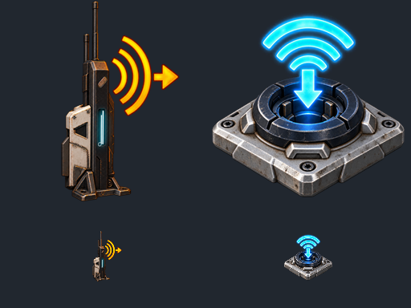

# Caretaker Wireless Fix

**1.000 Meter Funkübertragung für Strom, Treibstoffe, Wasser und Gase mit getrennten Kanälen und Hintergrundbetrieb** für *The Last Caretaker*. Diese eigenständige Mod repariert und erweitert die vorhandenen Wireless-Spielgeräte. Die ursprünglichen Modelle und Gegenstände stammen aus dem Spiel.

**Version 1.0.0 – Erstrelease**, geprüft mit Spielversion **0.10.0.653173 / Steam-Build 25982825** unter Windows. Die Modtexte sind deutsch.

[Download auf GitHub](https://github.com/C1yHAX/caretaker-wireless/releases/tag/v1.0.0) · [Download auf GitLab](https://gitlab.com/c0d1ngf1eber/caretaker-wireless/-/releases/v1.0.0) · [Änderungsverlauf](CHANGELOG.md)

## Neue Ressourcen-Funkübertragung

Zusätzlich zum vorhandenen Funkstrom enthält dieses Paket je einen eigenen Sender und Empfänger für **neun weitere Ressourcen**. Pro Paar gibt es eine Freischaltung für **zwei Skillpunkte**:

| Ressource | Schlauch | Level |
|---|---|---|
| Benzin | Treibstoff | 18 |
| Diesel | Treibstoff | 18 |
| Rohöl | Treibstoff | 20 |
| Frischwasser | Wasser | 18 |
| Salzwasser | Wasser | 18 |
| Sauerstoff | Gas | 20 |
| COâ‚‚ | Gas | 20 |
| Methan | Gas | 21 |
| Dampf | Gas | 20 |

Die Stufen folgen den vorhandenen Wandbrücken (16–18), der Destillation (20) und dem Methan-Extraktor (19). Alle neuen Items tragen den Ressourcennamen. Die unterschiedlichen Antennen-/Anschluss-Icons bleiben erhalten; die native Anschlussgrafik zeigt die Ressource.

**Beispiel Diesel:** Tank → Treibstoffschlauch → **Diesel-Funksender**, zusätzlich ein Stromkabel an dessen zweiten Anschluss. Am Ziel **Diesel-Funkempfänger** → Treibstoffschlauch → Tank oder Verbraucher. Beide Geräte anvisieren und mit **Ö** denselben Kanal wählen. Für andere Ressourcen entsprechend passende Geräte und Schläuche verwenden.

- Reichweite **1.000 m**, Kanäle **1–9999**, Standard 1. Nur gleiche Ressourcenart und gleicher Kanal verbinden sich. Diesel und Benzin auf Kanal 1 bleiben getrennt.
- Ressourcen-Sender: **separater Strom- und Ressourcen-Eingang**. Empfänger: Ressourcen-Ausgang.
- Sender-Eigenbedarf: **1 kW Grundlast plus 1 kW je zugeordnetem Empfänger**. Es werden keine Ressourcen erzeugt oder umgewandelt.
- Nominal **72.000 Einheiten/h (20/s)**, abhängig vom angeschlossenen Netz. Senderpuffer: **1.000 Ressourceneinheiten und 1 kWh Strom**. Mehrere Empfänger teilen den verfügbaren Zufluss.
- Senderrezept: **4 Kunststoff + 4 Eisen**, 8 s, 20 Wh. Empfänger: **2 Kunststoff + 2 Eisen**, 4 s, 10 Wh. Gewicht 0 und Stapelgröße 99.999 entsprechen den übrigen Modpack-Wireless-Items.
- Hintergrund-Erkennung für alle **20 Gerätetypen** über einen gemeinsamen Scan nativer Persistenzkomponenten alle fünf Sekunden. Grenzen weiterhin 256 Gerätebereiche / 2.048 Objekte.

**Prüfstatus:** Die neuen Ressourcenpaare sind offline geprüft und erfolgreich gepackt/rückextrahiert. Lua-Tests mit Attrappen prüfen Ö-Bedienung, Geräteerkennung und gespeicherte Netze. **Nativer Ressourcenfluss, Platzierung und Speichern/Neuladen stehen noch als Spieltest aus.** Das Spiel wurde für diese Erweiterung nicht gestartet. Die früheren Spieltests weiter unten gelten für Funkstrom, nicht als Nachweis für die neuen Gas-/Flüssigkeitsgeräte.

## Was gegenüber den Original-Spielassets verbessert wurde

Der Vergleich bezieht sich auf die unveränderten Dateien des oben genannten Spielbuilds. Vorhandene Spielassets bedeuten nicht automatisch, dass jedes Gerät im unveränderten Spiel regulär freigeschaltet oder vollständig nutzbar ist.

| Bereich | Original-Spielassets | Caretaker Wireless Fix |
|---|---|---|
| Funkstrom-Reichweite | 10 m | **1.000 m** zwischen Sender und Empfänger |
| Getrennte Stromnetze | Keine von uns vorgefundene einstellbare Funkstrom-Kanalnummer | **Kanäle 1–9999**, Standard 1; nur gleiche Nummern verbinden sich |
| Senderzuordnung | Zuordnungsprobleme bei überlappenden Sendern | Ein versorgter Sender bleibt zuständig; Ersatzsender desselben Kanals können bei Ausfall übernehmen |
| Kabelanschlüsse | Unvollständige Kategorieangaben an Funkstrom und Datenrelais | Explizite Strom-/Datenkategorien und regulärer Empfänger-Stromausgang |
| Empfänger abbauen | Unvollständige Modul-/Zerlegeanbindung | Native Zerlegefunktion und Persistenzanbindung repariert |
| Entfernte Anlage | Normale Entladung kann die Geräteberechnung beenden | Benötigte Laufzeitgeräte bleiben aktiv, während die Umgebung entladen wird |
| Bedienung | Kein entsprechender Funkstrom-Kanaldialog | Gerät anvisieren und **Ö** drücken; normale E-/F-Kabelbedienung bleibt verfügbar |
| Wandbrücken | 5 m Basisreichweite | **50 m** für die vorhandenen Wandbrücken; zuvor durch „Longer Wireless Cables“ genutzt |
| Unterscheidbarkeit | Sender und Empfänger verwenden dasselbe Extender-Symbol | **Eigene Icons:** hohe Antenne mit orangefarbenen Sendewellen; flacher Anschluss mit blauen Empfangswellen. Dazu deutsche Namen und Beschreibungen |

Der Sender hat einen **1-kWh-Puffer**. Er benötigt **1 kW Grundlast plus 1 kW je aktiv verbundenem Empfänger**, zusätzlich zur übertragenen Leistung. Die Mod erzeugt keine kostenlose Energie; bei leerer Quelle und leerem Puffer endet die Versorgung.

Zusätzlich werden die bisherigen Modpack-Werte der sieben betroffenen Itemdefinitionen beibehalten: **Gegenstandsgewicht 0 und Stapelgröße 99.999**. Dies ist ebenfalls eine Abweichung vom unveränderten Spiel.



Die beiden transparenten Icons sind fest an die vorhandenen Gegenstände gebunden. Sie unterscheiden sich in Form, Farbe und Richtung der Pfeile. Die Texturen liegen unter eigenen Paketpfaden; das bisherige Extender-Icon, Wandbrücken und Signalrelais behalten ihre Symbole. Zwei statische 256×256-UI-Texturen benötigen zusammen etwa 512 KiB rohe Pixeldaten und keine zusätzliche laufende Skriptprüfung.

## Voraussetzungen und Download

- *The Last Caretaker*, Windows, Build **25982825 / 0.10.0.653173**. Andere Builds sind nicht bestätigt.
- **UE4SS v3.0.1-1125-g527a483b**, separat vom Originalprojekt: [geprüftes UE4SS-ZIP herunterladen](https://github.com/UE4SS-RE/RE-UE4SS/releases/download/experimental/UE4SS_v3.0.1-1125-g527a483b.zip). [Quellstand](https://github.com/UE4SS-RE/RE-UE4SS/commit/527a483b).
- **[AssetBridge von NotLazy](https://www.nexusmods.com/thelastcaretaker/mods/225), Version 0.4.0**, separat installieren. Es registriert die 18 neuen Items und neun Skills.
- Unser Release-Download **`Caretaker-Wireless-Fix-1.0.0.zip`**. Die automatisch erzeugten GitHub/GitLab-Quellcodearchive sind nicht der empfohlene Installationsdownload.

Die offizielle UE4SS-Datei wurde heruntergeladen und ihre DLL mit der getesteten Installation verglichen. SHA-256 des UE4SS-ZIP: `4f9762f812329a640c8cfa14444c2bb97ecc213b8320bd4c5433383c3eef48f7`. SHA-256 der `UE4SS.dll`: `91d5444f41d19d0bb502f0fbdc15d76421e20359e898caa39e41e134c8f87958`.

**Das vollständige Modpack und Caretaker Energy sind nicht erforderlich. AssetBridge ist seit der Ressourcen-Erweiterung erforderlich.** Die elf vorhandenen Asset-Overrides bleiben; 45 Ressourcen-Assets und zwei Icontexturen kommen hinzu. AssetBridge registriert **27 zusätzliche Item-/Skill-Einträge** aus `CaretakerWirelessFix_P.tlcaddon.json`. UE4SS ist erforderlich für Hintergrundbetrieb und Ö-Kanalbedienung. Es wird nicht im Mod-ZIP mitgeliefert.

## Installation

1. Spiel und Modmanager schließen. Vor einem Modwechsel eine Sicherung des Spielstands anlegen.
2. Falls noch nicht vorhanden: das oben verlinkte UE4SS-ZIP entpacken und dessen Inhalt in `<Spielordner>/Voyage/Binaries/Win64/` kopieren. Die DLL liegt anschließend unter `ue4ss/UE4SS.dll`; der Loader liegt neben der Spiel-EXE. Bei vorhandener UE4SS-Installation keine eigenen Einstellungen oder anderen Mods unbesehen überschreiben.
3. AssetBridge 0.4.0 nach der verlinkten Autorenanleitung installieren. Anschließend **`Caretaker-Wireless-Fix-1.0.0.zip`** vollständig entpacken. Im entpackten Verzeichnis ausführen und den Spielpfad anpassen:

   ```powershell
   powershell -ExecutionPolicy Bypass -File .\Install-Wireless.ps1 -GamePath 'E:\Games\steamapps\common\Voyage'
   ```

   Nur prüfen: denselben Aufruf um `-CheckOnly` ergänzen. Der Installer prüft Spielbuild, UE4SS-DLL und alle 15 Moddateien und das Vorhandensein des AssetBridge-Pakets, sichert bereits vorhandene Zieldateien und kopiert die Mod. Er installiert UE4SS nicht automatisch und bearbeitet keine Spielstände.

4. Ältere **zusätzliche** Kopien von `CaretakerWirelessFix` oder `zLong_Wireless_Cables_P` außerhalb des gesamten `Paks`-Verzeichnisses aufbewahren. Nur eine Version laden. Der Installer tauscht die Dateien am vorgesehenen Ziel aus, sucht aber keine beliebig benannten fremden Modordner.
5. Spiel vollständig neu starten. Bereits platzierte Sender und Empfänger behalten ihre Identität; ein Neubau ist für dieses Update nicht nötig.

Manuell ist auch das Kopieren des enthaltenen `Voyage`-Ordners in den Spielordner möglich. Alle drei Bereiche gehören zusammen:

```text
Voyage/Content/Paks/~mods/CaretakerWirelessFix/        3 Containerdateien + .tlcaddon.json
Voyage/Binaries/Win64/ue4ss/Mods/CaretakerWirelessBackground/
Voyage/Binaries/Win64/ue4ss/Mods/CaretakerWirelessControls/
```

Das vollständige Caretaker-Modpack ab **1.0.0** enthält diese Fassung bereits. Dort keine zweite Kopie hinzufügen. Andere Mods, die dieselben elf Assetpfade verändern, können kollidieren; die Pfade stehen in [ASSET-CHANGES.md](ASSET-CHANGES.md).

## Funkstrom einrichten

1. Stromquelle mit normalem Stromkabel an den **Funkstrom-Sender** anschließen.
2. Einen **Funkstrom-Empfänger** innerhalb von 1.000 m aufstellen und mit Verbraucher oder Akku verkabeln. Die Quelle muss Verbraucher und Sender-Eigenbedarf versorgen können.
3. Nahe an ein Funkgerät gehen, Gerät oder Anschluss anvisieren und **Ö ohne Zusatztaste** drücken.
4. Im Menü **„Funkstrom-Kanal“** dieselbe Zahl für Sender und zugehörige Empfänger wählen. Die Pfeile ändern sie in Einerschritten. Unterschiedliche Anlagen erhalten unterschiedliche Nummern, beispielsweise 1 und 2.
5. Menü schließen, einige Sekunden auf die Neuverbindung warten und normal speichern.

Mehrere Empfänger desselben Kanals teilen die verfügbare Leistung. Ein Empfänger weicht bei Stromausfall nicht auf andere Kanäle aus. E und F behalten die normale Kabelbedienung. Ö ist ein separater Befehl und erscheint nicht als normale Interaktion-2-Einblendung.

Auf einer deutschen Windows-Tastatur entspricht Ö `KeyName = 'OEM_THREE'`. Bei anderer Tastatur kann dies unter `CaretakerWirelessControls/Scripts/config.lua` geändert werden; `KeyLabel` ist nur die Beschriftung. Danach neu starten. Das Menü öffnet nur beim Anvisieren eines Funkstrom-Geräts aus der Nähe und nicht über einem bereits offenen Dialog.

**Wandbrücken und Funk-Datenrelais sind andere Systeme.** Wandbrücken bilden passende Paare derselben Kategorie bis 50 m unter den Montagebedingungen des Spiels. Datenrelais übertragen Steuersignale und verwenden ihre eigene Kanalbedienung; sie versorgen keine Stromverbraucher.

## Hintergrundbetrieb und Performance

Die Erweiterung hält die benötigten nativen Laufzeitgeräte einschließlich verbundener Kabel, Quellen, Verbraucher und Befestigungen aktiv. Landschaft und Weltgeometrie dürfen entladen werden. Das gilt während des laufenden Spiels; es gibt keine Berechnung bei beendetem Spiel.

- Netzprüfung alle **fünf Sekunden**, keine globale Suche pro Bild. Die anfängliche Wiederherstellung beginnt ungefähr **25–30 Sekunden nach dem Weltwechsel**.
- Geschützt werden native Gerätebereiche von **100 × 100 m**; weitere platzierte Objekte im selben Bereich können mit aktiv bleiben.
- Schutzgrenzen: **256 Gerätebereiche / 2.048 platzierte Objekte**. Bei Überschreitung gilt die normale Entladung; eine Meldung erscheint im UE4SS-Protokoll.
- Entfernte physikalische Körper werden vor Bewegung ohne geladenen Boden gesichert und beim Zurückkehren freigegeben. Daher werden unbesetzte entfernte Boote nicht weiter physikalisch bewegt.
- Der Ö-Handler prüft im Leerlauf alle 50 ms nur ein Lua-Flag. Er fragt das anvisierte Gerät erst nach einem Tastendruck ab.

Die native Simulation der aktiven Maschinen verursacht weiterhin Aufwand. Es gibt keine pauschale FPS-Zusage für große Fabriken. Einstellungen für die Grenzen stehen unter `CaretakerWirelessBackground/Scripts/config.lua`.

## Bisherige Funkstrom-Prüfung und bekannte Grenzen

Geprüft wurden Stromfluss, Energiebilanz, Versorgungsabbruch/Wiederanlauf, Reichweitengrenze, mehrere Empfänger, Senderwechsel, Kanaltrennung und Zerlegen. In einer frischen Testwelt lief eine Verbindung über **997 m**, während der Spieler **20 km** entfernt war und die Umgebung entladen wurde. Native gespeicherte Gerätedaten einschließlich Kanälen und Kabeln wurden ohne Laden der Landschaft wiederhergestellt.

Für den Erstrelease wurden beide nativen Kanaldialoge, die registrierte Ö-Funktion und der Ablauf **Kabel greifen → F verwenden → Kabel wieder anschließen** an Sender und Empfänger geprüft. Die Ö-Funktion wurde programmgesteuert über den registrierten Callback ausgelöst; ihre Zuordnung zum deutschen Windows-Tastaturlayout wurde separat geprüft. Danach funktionierte die Stromübertragung. Die 13 Assetpakete einschließlich der zwei neuen Icontexturen wurden nach dem Packen rückextrahiert; ihre Exportdaten waren bytegleich. Beide neuen Icons wurden von der Spielengine geladen, bei 256 und 64 Pixeln gerendert und ihre Item-Zuordnungen bestätigt. Alle bisherigen Gameplay-Exports und Lua-Dateien sind durch die Icon-Ergänzung unverändert.

Die Berichte in [verification/](verification/) dokumentieren die jeweilige getestete Version; Containerhashes in den Berichten kennzeichnen den jeweiligen Testaufbau. Ein vollständiger Langzeittest großer bestehender Fabriken, aller anderen Mods und ein manueller Speichern-/Neustart-Zyklus einer solchen Basis stehen aus. Die beschriebenen Grenzen gelten auch für diesen Erstrelease. Es wurden keine privaten Spielstände, Logs, Anmeldedaten oder anderen Mods veröffentlicht.

## Entfernen und Zurücksetzen

Spiel schließen. Vor dem Entfernen neue Ressourcen-Geräte zerlegen, ihre Inventargegenstände entfernen und gefüllte Puffer leeren; ihre zusätzlichen Identitäten benötigen die Mod. Für vollständiges Entfernen `CaretakerWirelessFix` aus `Paks` und beide Lua-Modordner aus `ue4ss/Mods` herausnehmen. Die ursprünglichen Funkstrom-/Wandbrücken-Spielgeräte fallen auf ihre ursprünglichen Funktionen zurück; Reichweite, Kanalfilterung, Reparaturen und Hintergrundbetrieb entfallen. Vorher benötigte Anlagen auf normale Kabelversorgung umstellen. Der Installer speichert ersetzte Dateien unter `CaretakerModBackups` im Spielordner.

Wird nur `CaretakerWirelessBackground` entfernt, endet die zusätzliche Fernsimulation. Wird nur `CaretakerWirelessControls` entfernt, bleiben gespeicherte Kanäle erhalten, sind aber nicht mehr mit Ö bearbeitbar.

## Herkunft und Quellcode

Die Geräte, Modelle und abgeleiteten gekochten Assets stammen aus *The Last Caretaker* von Channel37. Dies ist eine inoffizielle Community-Mod. [THIRD-PARTY-NOTICES.md](THIRD-PARTY-NOTICES.md) beschreibt Herkunft und Abhängigkeiten; [ASSET-CHANGES.md](ASSET-CHANGES.md) listet die Änderungen.

Eigene Lua-Skripte, Installer, Paketierung und Dokumentation stehen unter MIT, siehe [LICENSE](LICENSE). Diese Lizenz erstreckt sich nicht auf Spielinhalte. Die Lua-Quellen liegen direkt in den beiden installierbaren Modordnern. Die elf bearbeiteten Basis-Spielassets, 45 Ressourcen-Assets und zwei eigenen Icontexturen werden als fertiger Container bereitgestellt; dieser Repository-Stand enthält keinen vollständigen Editor-/Asset-Build. PNG-Quellen, Prompts und der IconBuilder sind enthalten; siehe [BUILDING-ICONS.md](BUILDING-ICONS.md). `tools/package_release.py` prüft die bereitgestellten Dateien und erzeugt das Release-ZIP reproduzierbar.

## English

Distinct orange transmitter and blue receiver icons show the actual antenna/socket forms and outgoing/incoming power direction. Extends the game's existing wireless devices with **1,000 m power transmission**, **channels 1–9999**, repaired cable sockets and receiver dismantling, and native device simulation while surrounding scenery is unloaded. Look at a sender or receiver nearby and press **Ö on a German keyboard** to configure its channel; the key is configurable. E/F cable interactions remain available. Wall bridges use 50 m; wireless data relays remain a separate control-signal system. Seven affected item definitions also retain modpack weight 0 / stack size 99,999.

Requires the game build and separately linked, hash-verified **UE4SS v3.0.1-1125-g527a483b**. No full modpack or Energy mod required. **AssetBridge 0.4.0 is now required** for the additional resource devices and skills. Download the named release ZIP, close the game, run `Install-Wireless.ps1 -GamePath '<game folder>'`, and restart. First release: controlled native-engine tests passed, but large-base long-term play and arbitrary mod combinations have not been validated. German in-game text. Original game assets remain the property of their respective owners.

The extension adds nine resource sender/receiver pairs: petrol, diesel, crude oil, fresh water, salt water, oxygen, carbon dioxide, methane and steam. Each transmitter needs electrical supply plus its matching hose input. 1,000 m range, channels 1–9999, same resource/channel only, nominal 72,000 units/hour, 1,000-unit resource buffer. Unlock levels 18–21, two points per pair. **Native flow, placement and save/reload tests of these additional resource pairs remain pending; offline checks passed.** Version remains 1.0.0.
