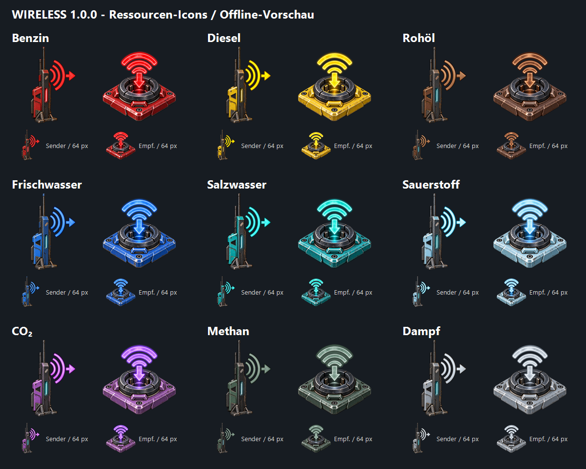

# Caretaker Wireless Fix

**1.000 Meter Funkübertragung für Strom, Treibstoffe, Wasser und Gase mit getrennten Kanälen und Hintergrundbetrieb** für *The Last Caretaker*. Diese eigenständige Mod repariert und erweitert die vorhandenen Wireless-Spielgeräte. Die ursprünglichen Modelle und Gegenstände stammen aus dem Spiel.

**Version 1.0.0 – Erstrelease**, geprüft mit Spielversion **0.10.0.653173 / Steam-Build 25982825** unter Windows. Die Modtexte sind deutsch.

[Download auf GitHub](https://github.com/C1yHAX/caretaker-wireless/releases/tag/v1.0.0) · [Download auf GitLab](https://gitlab.com/c0d1ngf1eber/caretaker-wireless/-/releases/v1.0.0) · [Änderungsverlauf](CHANGELOG.md)

## Channel key / Kanalwechsel-Taste

**English:** Close the game and edit
`Voyage/Binaries/Win64/ue4ss/Mods/CaretakerWirelessControls/Scripts/config.lua`
inside your game installation. For **F8**, set `KeyName = 'F8'` and
`Modifiers = {}`, then restart. For **Ctrl+F8**, use `Modifiers = {'CONTROL'}`.
Other examples: `'F9'`, `'K'`, `'HOME'`; optional modifiers are `'CONTROL'`,
`'ALT'` and `'SHIFT'`. Key names are case-insensitive. Use a
[UE4SS key name](https://docs.ue4ss.com/lua-api/table-definitions/key.html),
not `Key.F8` or a translated key caption. The default `'OEM_THREE'` retains
**Ö on German layouts / the backtick key on US layouts**. Aim at a nearby
wireless transmitter or receiver and press your configured key. Existing
in-game descriptions may still mention Ö; the configuration determines the key.

**Deutsch:** Spiel schließen und die oben genannte `config.lua` im
Spielinstallationsordner bearbeiten. Für **F8** `KeyName = 'F8'` und
`Modifiers = {}` eintragen, dann neu starten. Für **Strg+F8**
`Modifiers = {'CONTROL'}` verwenden. Weitere Beispiele: `'F9'`, `'K'`,
`'HOME'`; mögliche Zusatztasten sind `'CONTROL'`, `'ALT'` und `'SHIFT'`.
Groß-/Kleinschreibung ist egal. Den UE4SS-Tastennamen verwenden, nicht `Key.F8`
oder eine übersetzte Tastenbeschriftung. Standard bleibt `'OEM_THREE'`
(**Ö bei deutschem Layout / Backtick bei US-Layout**). Ein Funkgerät aus der
Nähe anvisieren und die eingestellte Taste drücken. Ältere Spielbeschreibungen
können weiterhin Ö nennen; maßgeblich ist die Konfiguration.

**Updates / Aktualisierung:** Back up your edited `config.lua` before replacing
files and reapply your key settings afterwards. / Angepasste `config.lua` vor
dem Ersetzen sichern und eigene Tasteneinstellungen anschließend übernehmen.
Avoid keys already used by the game or another mod. Invalid settings or a
detected UE4SS binding conflict disable only this hotkey and write a clear
message to `UE4SS.log`; recipe recovery and resource transfer remain active.
/ Belegte Spiel-/Modtasten vermeiden. Bei ungültigen Einstellungen oder einem
erkannten UE4SS-Tastenkonflikt wird nur dieser Hotkey deaktiviert und eine
Meldung in `UE4SS.log` geschrieben; Bauplanwiederherstellung und Übertragung
bleiben aktiv. No new in-game test for this config update: 22 offline Lua tests
passed. / Für dieses Konfigurationsupdate kein neuer Spieltest: 22 Offline-Lua-Tests bestanden.

## Ressourcenpuffer bleiben erhalten

Volle 1.000-Einheiten-Puffer für Flüssigkeiten und Gase werden nicht mehr auf null
zurückgesetzt. Wenn ein Empfänger keinen angeschlossenen Verbraucher hat oder
sein Ziel voll ist, stoppt der Zufluss. Sobald wieder Platz frei wird, wird die
fehlende Menge nachgeliefert. Die regulären Stromkosten bleiben bestehen.

Im separaten Testspielstand mit komplettem Modpack wurden alle neun Ressourcen
sowohl an den einzelnen Sendern als auch am Universal-Sender geprüft. Die
Messungen umfassen unverbundene Ausgänge, volle Ziele, 250 Einheiten Entnahme und
große Spielerentfernung. Stromübertragung wurde zusätzlich geprüft.
[Prüfbericht](verification/resource-conservation-20261026.json).

## Neuer Universal-Sender

Der Universal-Sender verwendet das freigegebene Antennenmodell mit **5,024 m
Höhe**, drei Füßen im Abstand von 120° und zwei Reihen mit je fünf echten
Spielanschlüssen. Der senkrechte Abstand beträgt **48 cm**. Die Anschlüsse ragen
8 cm weiter aus dem Gehäuse; die Übergänge der elfenbeinfarbenen Lackierung sind
an das ursprüngliche Gehäuse angepasst. Das Gehäuse hat keine aufgesetzte
Abdeckplatte. Zwei cyanfarbene Lichtquellen und eine rote Signalleuchte ergänzen
die leuchtenden Oberflächen. Die Pufferkorrektur verändert dieses Modell,
Materialien, Lichtquellen und Anschlusspositionen nicht.

Der Universalempfänger wird nicht mehr neu hergestellt oder freigeschaltet.
Seine gespeicherten Objektkennungen bleiben für vorhandene Exemplare erhalten.
Am Ziel dienen die einzelnen Ressourcenempfänger. Es gibt 21 reguläre
Freischaltungen: zehn einzelne Sender, zehn einzelne Empfänger und den
Universal-Sender. Stufen 18–22 und die aktuellen null Skillpunktkosten bleiben.
Die Wiederherstellung berücksichtigt bereits verdiente Baupläne und frühere
Paar-Freischaltungen; sie vergibt keinen neuen Universalempfänger.

**Spielprüfung vom 26.10.2026 mit separatem Testprofil:** Bau über das Baumenü
mit normaler Bestätigung und Materialverbrauch; Dieselanschluss an beiden
Enden mit E verbunden; tatsächlicher Dieselzufluss; Ö-Kanalmenü und Änderung;
rote/grüne Betriebsanzeige; Speichern und Kaltstart mit wiederhergestelltem
Sender und Kanal. Alle zehn Ressourcen wurden zusätzlich in einem nativen
Testnetz zwischen Universal-Sender und einzelnen Empfängern geprüft, geladen
und bei über 18 km Spielerabstand. Das ist kein vollständiger manueller
Kabel-/Abrissdurchlauf für alle Geräte. [Prüfumfang](verification/antenna-revision2-20261026.json)

Der Sender behält seine Item-, Blueprint- und Anschlusskennungen. Bereits
platzierte Sender erhalten das neue Aussehen beim Neustart; wegen des größeren
Gehäuses benötigen sie mehr Freiraum. Ein Langzeittest großer Anlagen mit
beliebigen Fremdmods ist nicht erfolgt. Version bleibt **1.0.0**.

## Frühere Geräteprüfung vom 25.10.2026

**Freigeschaltet, aber im Baumenü fehlend:** Der native Bauplanspeicher war auf
1.024 Einträge begrenzt. Eine Fähigkeit konnte erfolgreich freigeschaltet werden,
obwohl für ihre beiden Geräte kein Platz mehr vorhanden war. Die Mod bereitet
den Bauplanspeicher vor dem Laden mit mindestens 4.096 Plätzen vor und stellt
fehlende, bereits durch Fähigkeiten oder Scans verdiente Wireless-Baupläne wieder
her. Bereits verdiente Baupläne und alte Paar-Freischaltungen werden den
getrennten Fähigkeiten zugeordnet. Vorhandene Einträge werden nicht gelöscht.
Normale Inventare und Materialanforderungen bleiben unverändert.

Nach der Installation vollständig neu starten, den Spielstand laden und etwa
zehn Sekunden warten. Das Baumenü danach neu öffnen. Bereits freigeschaltete
Fähigkeiten müssen nicht erneut gekauft werden. Sender und Empfänger haben
getrennte Einträge. Der Universalempfänger wird nicht mehr angeboten.

**Gerätezuordnung:** Der orange Funkstrom-Sender hat einen Stromanschluss. Der
gelbe Diesel-Funksender hat einen Strom- und einen Treibstoffanschluss. Die vier
Wandanschlussarten sind Strom, Treibstoff, Gas und Wasser; sie sind zusätzlich zu
den einzelnen Funkempfängern vorhanden. Ein Treibstoff-Wandanschluss deckt die
Treibstoffressourcen ab, ein Gas-Wandanschluss die Gasressourcen.

**Neustart und Fernbetrieb:** Gespeicherte entfernte Netze werden zunächst über
reguläre Streamingquellen des Spiels initialisiert. Höchstens vier temporäre
Quellen bestehen gleichzeitig; danach werden sie entfernt und die Umgebung
darf wieder entladen. Physiksperren betreffen ausschließlich tatsächlich
simulierende Körper. Bereits zerlegte, vom Spiel gepoolte Funkgeräte werden bei
der Gerätesuche ignoriert. Dadurch bleibt kein solcher Geräteeintrag als
zusätzlicher Hintergrund-Anker bestehen.

Mit dem vollständigen Modpack, unverändertem **Dynamic Grinder 1.0.1** und
**AssetBridge 0.4.1** wurden in einem separaten Testprofil geprüft: zehn
Fähigkeiten und ihre 20 neuen Baupläne; native Herstellung und Platzierung;
49 Ressourcenanschlüsse der 22 Funkgeräte; alle zehn Ressourcen über Einzel-
und Universalgeräte; Kanaltrennung; Entladung, Rückkehr und Kaltstart;
vier Wandbrückenarten sowie Signalrelais. Die Tests verwenden die tatsächlichen
Spielfunktionen. Sie sind keine manuelle Prüfung jedes Mausklicks.

Dampf wird mit eigens konfigurierten nativen Testreservoirs eingespeist. Deren
vorübergehende Ressourcenkonfiguration und Schlauchverbindung werden nach einem
Neustart erneut eingerichtet; die gespeicherten Funkgeräte bleiben dabei
unverändert. Ein Langzeittest beliebig großer Fabriken ist damit nicht ersetzt.
Der anonymisierte [Prüfbericht](verification/wireless-audit-20261025.json)
beschreibt den Umfang. Private Spielstände und Rohprotokolle werden nicht
veröffentlicht.

## Universal-Sender mit einzelnen Empfängern

Der **Universal-Funksender (1.000 m)** nimmt zehn Ressourcen über getrennte
Anschlüsse an. Am Ziel werden einzelne Strom-, Treibstoff-, Wasser- oder
Gasempfänger auf denselben Ö-Kanal eingestellt. Der frühere Universalempfänger
ist ausschließlich für vorhandene Spielstände enthalten. Details und aktueller
Prüfstatus: [UNIVERSAL.md](UNIVERSAL.md).

## Neue Ressourcen-Funkübertragung

Zusätzlich zum vorhandenen Funkstrom enthält dieses Paket je einen eigenen Sender und Empfänger für **neun weitere Ressourcen**. Pro Paar gibt es eine Freischaltung für **zwei Skillpunkte**:

| Ressource | Schlauch | Level |
|---|---|---|
| Benzin | Treibstoff | 18 |
| Diesel | Treibstoff | 18 |
| Rohöl | Treibstoff | 20 |
| Frischwasser | Wasser | 18 |
| Salzwasser | Wasser | 18 |
| Sauerstoff | Gas | 20 |
| CO₂ | Gas | 20 |
| Methan | Gas | 21 |
| Dampf | Gas | 20 |

Die Stufen folgen den vorhandenen Wandbrücken (16–18), der Destillation (20) und dem Methan-Extraktor (19). Alle neuen Items tragen den Ressourcennamen. Jede Ressourcenart besitzt farblich angepasste Sender-/Empfänger-Icons; die native Anschlussgrafik zeigt ebenfalls die Ressource.

**Beispiel Diesel:** Tank → Treibstoffschlauch → **Diesel-Funksender**, zusätzlich ein Stromkabel an dessen zweiten Anschluss. Am Ziel **Diesel-Funkempfänger** → Treibstoffschlauch → Tank oder Verbraucher. Beide Geräte anvisieren und mit **Ö** denselben Kanal wählen. Für andere Ressourcen entsprechend passende Geräte und Schläuche verwenden.

- Reichweite **1.000 m**, Kanäle **1–9999**, Standard 1. Nur gleiche Ressourcenart und gleicher Kanal verbinden sich. Diesel und Benzin auf Kanal 1 bleiben getrennt.
- Ressourcen-Sender: **separater Strom- und Ressourcen-Eingang**. Empfänger: Ressourcen-Ausgang.
- Sender-Eigenbedarf: **1 kW Grundlast plus 1 kW je zugeordnetem Empfänger**. Es werden keine Ressourcen erzeugt oder umgewandelt.
- Nominal **72.000 Einheiten/h (20/s)**, abhängig vom angeschlossenen Netz. Senderpuffer: **1.000 Ressourceneinheiten und 1 kWh Strom**. Mehrere Empfänger teilen den verfügbaren Zufluss.
- Senderrezept: **4 Kunststoff + 4 Eisen**, 8 s, 20 Wh. Empfänger: **2 Kunststoff + 2 Eisen**, 4 s, 10 Wh. Gewicht 0 und Stapelgröße 99.999 entsprechen den übrigen Modpack-Wireless-Items.
- Hintergrund-Erkennung für alle **22 Gerätetypen** über einen gemeinsamen Scan nativer Persistenzkomponenten alle fünf Sekunden. Grenzen weiterhin 256 Gerätebereiche / 2.048 Objekte.

**Prüfstatus:** Alle spezialisierten Paare und das Universalpaar wurden zusätzlich zu den Offline-Prüfungen in der laufenden Spielengine geprüft. Aktueller Umfang und Grenzen stehen im Abschnitt vom 25.10.2026 oben.

## Was gegenüber den Original-Spielassets verbessert wurde

Der Vergleich bezieht sich auf die unveränderten Dateien des oben genannten Spielbuilds. Vorhandene Spielassets bedeuten nicht automatisch, dass jedes Gerät im unveränderten Spiel regulär freigeschaltet oder vollständig nutzbar ist.

| Bereich | Original-Spielassets | Caretaker Wireless Fix |
|---|---|---|
| Funkstrom-Reichweite | 10 m | **1.000 m** zwischen Sender und Empfänger |
| Getrennte Stromnetze | Keine von uns vorgefundene einstellbare Funkstrom-Kanalnummer | **Kanäle 1–9999**, Standard 1; nur gleiche Nummern verbinden sich |
| Senderzuordnung | Zuordnungsprobleme bei überlappenden Sendern | Ein versorgter Sender bleibt zuständig; Ersatzsender desselben Kanals können bei Ausfall übernehmen |
| Kabelanschlüsse | Unvollständige Kategorieangaben an Funkstrom und Datenrelais | Explizite Strom-/Datenkategorien und regulärer Empfänger-Stromausgang |
| Empfänger abbauen | Unvollständige Modul-/Zerlegeanbindung | Native Zerlegefunktion und Persistenzanbindung repariert |
| Entfernte Anlage | Normale Entladung kann die Geräteberechnung beenden | Benötigte Laufzeitgeräte bleiben aktiv, während die Umgebung entladen wird |
| Bedienung | Kein entsprechender Funkstrom-Kanaldialog | Gerät anvisieren und **Ö** drücken; normale E-/F-Kabelbedienung bleibt verfügbar |
| Wandbrücken | 5 m Basisreichweite | **50 m** für die vorhandenen Wandbrücken; zuvor durch „Longer Wireless Cables“ genutzt |
| Unterscheidbarkeit | Sender und Empfänger verwenden dasselbe Extender-Symbol | **Eigene Icons:** hohe Antenne mit orangefarbenen Sendewellen; flacher Anschluss mit blauen Empfangswellen. Dazu deutsche Namen und Beschreibungen |

Der Sender hat einen **1-kWh-Puffer**. Er benötigt **1 kW Grundlast plus 1 kW je aktiv verbundenem Empfänger**, zusätzlich zur übertragenen Leistung. Die Mod erzeugt keine kostenlose Energie; bei leerer Quelle und leerem Puffer endet die Versorgung.

Zusätzlich werden die bisherigen Modpack-Werte der sieben betroffenen Itemdefinitionen beibehalten: **Gegenstandsgewicht 0 und Stapelgröße 99.999**. Dies ist ebenfalls eine Abweichung vom unveränderten Spiel.


Die beiden transparenten Icons sind fest an die vorhandenen Gegenstände gebunden. Sie unterscheiden sich in Form, Farbe und Richtung der Pfeile. Die Texturen liegen unter eigenen Paketpfaden; das bisherige Extender-Icon, Wandbrücken und Signalrelais behalten ihre Symbole. Zwei statische 256×256-UI-Texturen benötigen zusammen etwa 512 KiB rohe Pixeldaten und keine zusätzliche laufende Skriptprüfung.

## Farbige Ressourcen-Icons

Alle 18 Ressourcen-Geräte besitzen ein eigenes transparentes Icon. Sender zeigen eine hohe Antenne mit einem ausgehenden Pfeil; Empfänger einen flachen Anschluss mit einem eingehenden Pfeil. Die getrennten Freischaltungen zeigen jeweils den passenden Sender oder Empfänger. Die Farbgebung gilt für die Menüsymbole.

| Ressource | Iconfarbe |
|---|---|
| Benzin | Rot |
| Diesel | Gelb |
| Methan | Gedecktes Graugrün, an die Methan-Tanks angelehnt |
| Rohöl | Braun / Kupfer |
| Frischwasser | Blau |
| Salzwasser | Türkis |
| Sauerstoff | Eisblau |
| CO₂ | Violett |
| Dampf | Silbergrau |



Die 18 zusätzlichen Texturen haben jeweils 256 × 256 Pixel und benötigen zusammen 4,5 MiB unkomprimierte Pixeldaten. Sie führen keine zusätzlichen Laufzeitskripte aus. Bestehende Geräte behalten ihre Identität und müssen für das Icon-Update nicht neu gebaut werden. **Version bleibt 1.0.0.** Die Icon-Imports, Textur-Payloads und Container-Rückextraktion sind geprüft; ein neuer Spielstart oder nativer UI-Test wurde nicht ausgeführt.

## Voraussetzungen und Download

- *The Last Caretaker*, Windows, Build **25982825 / 0.10.0.653173**. Andere Builds sind nicht bestätigt.
- **UE4SS v3.0.1-1125-g527a483b**, separat vom Originalprojekt: [geprüftes UE4SS-ZIP herunterladen](https://github.com/UE4SS-RE/RE-UE4SS/releases/download/experimental/UE4SS_v3.0.1-1125-g527a483b.zip). [Quellstand](https://github.com/UE4SS-RE/RE-UE4SS/commit/527a483b).
- **[AssetBridge von NotLazy](https://www.nexusmods.com/thelastcaretaker/mods/225), Version 0.4.1**, separat installieren. Es registriert 20 zusätzliche Items und 22 Skills, einschließlich der für alte Spielstände erhaltenen Universalempfänger-Einträge.
- Unser Release-Download **`Caretaker-Wireless-Fix-1.0.0.zip`**. Die automatisch erzeugten GitHub/GitLab-Quellcodearchive sind nicht der empfohlene Installationsdownload.

Die offizielle UE4SS-Datei wurde heruntergeladen und ihre DLL mit der getesteten Installation verglichen. SHA-256 des UE4SS-ZIP: `4f9762f812329a640c8cfa14444c2bb97ecc213b8320bd4c5433383c3eef48f7`. SHA-256 der `UE4SS.dll`: `91d5444f41d19d0bb502f0fbdc15d76421e20359e898caa39e41e134c8f87958`.

**Das vollständige Modpack und Caretaker Energy sind nicht erforderlich. AssetBridge ist seit der Ressourcen-Erweiterung erforderlich.** Der bisherige Wireless-Container enthält 95 Assetpakete; der neue Antennencontainer ergänzt neun eigene Grafikassets. AssetBridge registriert **42 zusätzliche Item-/Skill-Einträge** aus `CaretakerWirelessFix_P.tlcaddon.json`. UE4SS ist erforderlich für Hintergrundbetrieb und Ö-Kanalbedienung. Es wird nicht im Mod-ZIP mitgeliefert.

## Installation

1. Spiel und Modmanager schließen. Vor einem Modwechsel eine Sicherung des Spielstands anlegen.
2. Falls noch nicht vorhanden: das oben verlinkte UE4SS-ZIP entpacken und dessen Inhalt in `<Spielordner>/Voyage/Binaries/Win64/` kopieren. Die DLL liegt anschließend unter `ue4ss/UE4SS.dll`; der Loader liegt neben der Spiel-EXE. Bei vorhandener UE4SS-Installation keine eigenen Einstellungen oder anderen Mods unbesehen überschreiben.
3. AssetBridge 0.4.1 nach der verlinkten Autorenanleitung installieren. Anschließend **`Caretaker-Wireless-Fix-1.0.0.zip`** vollständig entpacken und den enthaltenen **`Voyage`**-Ordner in den Spielinstallationsordner kopieren, der bereits einen Unterordner `Voyage` enthält. Alle 20 Moddateien gehören zusammen; bei einem Update die Dateien am selben Ziel ersetzen.
4. Ältere **zusätzliche** Kopien von `CaretakerWirelessFix` oder `zLong_Wireless_Cables_P` außerhalb des gesamten `Paks`-Verzeichnisses aufbewahren. Nur eine Version laden. Der optionale PowerShell-Installer bleibt im Repository und wird nicht ins Mod-ZIP gepackt.

5. Spiel vollständig neu starten. Bereits platzierte Sender und Empfänger behalten ihre Identität; ein Neubau ist für dieses Update nicht nötig.

Im kopierten `Voyage`-Ordner gehören alle drei Bereiche zusammen:

```text
Voyage/Content/Paks/~mods/CaretakerWirelessFix/        6 Containerdateien + .tlcaddon.json
Voyage/Binaries/Win64/ue4ss/Mods/CaretakerWirelessBackground/
Voyage/Binaries/Win64/ue4ss/Mods/CaretakerWirelessControls/
```

Das vollständige Caretaker-Modpack ab **1.0.0** enthält diese Fassung bereits. Dort keine zweite Kopie hinzufügen. Andere Mods, die dieselben elf Assetpfade verändern, können kollidieren; die Pfade stehen in [ASSET-CHANGES.md](ASSET-CHANGES.md).

## Funkstrom einrichten

1. Stromquelle mit normalem Stromkabel an den **Funkstrom-Sender** anschließen.
2. Einen **Funkstrom-Empfänger** innerhalb von 1.000 m aufstellen und mit Verbraucher oder Akku verkabeln. Die Quelle muss Verbraucher und Sender-Eigenbedarf versorgen können.
3. Nahe an ein Funkgerät gehen, Gerät oder Anschluss anvisieren und **Ö ohne Zusatztaste** drücken.
4. Im Menü **„Funkstrom-Kanal“** dieselbe Zahl für Sender und zugehörige Empfänger wählen. Die Pfeile ändern sie in Einerschritten. Unterschiedliche Anlagen erhalten unterschiedliche Nummern, beispielsweise 1 und 2.
5. Menü schließen, einige Sekunden auf die Neuverbindung warten und normal speichern.

Mehrere Empfänger desselben Kanals teilen die verfügbare Leistung. Ein Empfänger weicht bei Stromausfall nicht auf andere Kanäle aus. E und F behalten die normale Kabelbedienung. Ö ist ein separater Befehl und erscheint nicht als normale Interaktion-2-Einblendung.

Die Taste und optionale Zusatztasten stehen in `CaretakerWirelessControls/Scripts/config.lua`; Beispiele und US-Tastaturhinweise stehen oben unter **Channel key / Kanalwechsel-Taste**. Die Protokoll-Beschriftung wird automatisch aus der tatsächlichen Belegung abgeleitet; ein älteres `KeyLabel` ist nicht mehr erforderlich. Danach neu starten. Das Menü öffnet nur beim Anvisieren eines Wireless-Geräts aus der Nähe und nicht über einem bereits offenen Dialog.

**Wandbrücken und Funk-Datenrelais sind andere Systeme.** Wandbrücken bilden passende Paare derselben Kategorie bis 50 m unter den Montagebedingungen des Spiels. Datenrelais übertragen Steuersignale und verwenden ihre eigene Kanalbedienung; sie versorgen keine Stromverbraucher.

## Hintergrundbetrieb und Performance

**Auch das Universal-Paar ist für alle zehn Ressourcen erfasst:** Strom, Benzin, Diesel, Rohöl, Frischwasser, Salzwasser, Sauerstoff, CO₂, Methan und Dampf. Die native Netzabfrage verfolgt Gruppen und Kabel rekursiv ohne Ressourcenfilter. Der Schutz umfasst die angeschlossenen Quellen und Verbraucher sowie die Kabel und physischen Anschlussbesitzer. Die Wiederherstellung gespeicherter Kabel verwendet die exakten Modul-/Anschluss-IDs, auch wenn ein Empfängerausgang inzwischen dem Sendermodul zugeordnet ist.

**Nativer Spieltest vom 24.10.2026:** Alle zehn Ressourcen liefen gleichzeitig über ein Universal-Paar mit 997 m Abstand weiter, während der Spieler 20–21 km entfernt war und die native Bereichsabfrage beide Umgebungen als entladen meldete. In rund 60 Sekunden kamen bei jeder Flüssigkeit/jedem Gas etwa weitere 1.200 Einheiten und beim Strom etwa 16,6 kWh an. Quell-/Zielmengen blieben bilanziert; Eigenbedarf des Paars 4 kW. Dampf wurde mit zwei nativen Testreservoirs geprüft. [Messbericht](verification/native-universal-resources.json)

**Rückkehrfehler behoben:** Die native Nachberechnung konnte bereits weitergelaufene Netze zusätzlich verteilen lassen. Ein kleiner nativer Schutz überspringt diese überflüssigen Netz-Durchläufe, wenn alle zugehörigen Geräte bereits aktuell sind. Die Wiederholungsprüfung mit den installierbaren Dateien bestand: auch beim Wiederladen der Umgebung unverändert 20 Einheiten/s pro Flüssigkeit/Gas und regulärer Stromverbrauch. Ein getrenntes Wasser-Kontrollnetz wurde vollständig entladen und anschließend weiterhin regulär nachberechnet. [Technik und Build](BUILDING-CATCHUP.md)

Die DLL prüft die exakte Spiel-EXE und beide Funktionssignaturen. Bei einer nicht unterstützten Version bleibt die normale Entladung aktiv; der Grund erscheint im UE4SS-Protokoll. Die Korrektur kopiert keine Ressourcen, verändert keine Modulzeitstempel und schaltet die Nachberechnung anderer Netze nicht global ab.

Außerdem korrigiert das Paket 36 typisierte Flüssigkeits-/Gasanschlüsse in 20 Blueprints: `bAutoInitialize=false` verhindert, dass die Initialisierung deren Ressourcenart mit Strom überschreibt. Alle Kismet-Instruktionen bleiben unverändert; 63 der 83 Assetpakete sind von dieser Anschlusskorrektur unberührt. [Asset-Werkzeug](BUILDING-SOCKETS.md)

Die zwölf ergänzenden Offline-Lua-Tests bestehen; sie prüfen Kanalbedienung, Hintergrundschutz und Kabelwiederherstellung mit simulierten Engine-Aufrufen.

Die Erweiterung hält die benötigten nativen Laufzeitgeräte einschließlich verbundener Kabel, Quellen, Verbraucher und Befestigungen aktiv. Landschaft und Weltgeometrie dürfen entladen werden. Das gilt während des laufenden Spiels; es gibt keine Berechnung bei beendetem Spiel.

- Netzprüfung alle **fünf Sekunden**, keine globale Suche pro Bild. Die anfängliche Wiederherstellung beginnt ungefähr **25–30 Sekunden nach dem Weltwechsel**. Sie wartet auf reguläres Laden und Initialisieren; höchstens vier temporäre Streamingquellen werden gleichzeitig eingesetzt und anschließend entfernt.
- Geschützt werden native Gerätebereiche von **100 × 100 m**; weitere platzierte Objekte im selben Bereich können mit aktiv bleiben.
- Schutzgrenzen: **256 Gerätebereiche / 2.048 platzierte Objekte**. Bei Überschreitung gilt die normale Entladung; eine Meldung erscheint im UE4SS-Protokoll.
- Entfernte physikalische Körper werden vor Bewegung ohne geladenen Boden gesichert und beim Zurückkehren freigegeben. Daher werden unbesetzte entfernte Boote nicht weiter physikalisch bewegt.
- Der Ö-Handler prüft im Leerlauf alle 50 ms nur ein Lua-Flag. Er fragt das anvisierte Gerät erst nach einem Tastendruck ab.

Die native Simulation der aktiven Maschinen verursacht weiterhin Aufwand. Es gibt keine pauschale FPS-Zusage für große Fabriken. Einstellungen für die Grenzen stehen unter `CaretakerWirelessBackground/Scripts/config.lua`.

## Bisherige Funkstrom-Prüfung und bekannte Grenzen

Geprüft wurden Stromfluss, Energiebilanz, Versorgungsabbruch/Wiederanlauf, Reichweitengrenze, mehrere Empfänger, Senderwechsel, Kanaltrennung und Zerlegen. In einer frischen Testwelt lief eine Verbindung über **997 m**, während der Spieler **20 km** entfernt war und die Umgebung entladen wurde. Gespeicherte Gerätedaten einschließlich Kanälen und Kabeln werden über eine begrenzte reguläre Initialisierung wiederhergestellt; anschließend darf die Landschaft entladen werden.

Für den Erstrelease wurden beide nativen Kanaldialoge, die registrierte Ö-Funktion und der Ablauf **Kabel greifen → F verwenden → Kabel wieder anschließen** an Sender und Empfänger geprüft. Die Ö-Funktion wurde programmgesteuert über den registrierten Callback ausgelöst; ihre Zuordnung zum deutschen Windows-Tastaturlayout wurde separat geprüft. Danach funktionierte die Stromübertragung. Die 13 Assetpakete einschließlich der zwei neuen Icontexturen wurden nach dem Packen rückextrahiert; ihre Exportdaten waren bytegleich. Beide neuen Icons wurden von der Spielengine geladen, bei 256 und 64 Pixeln gerendert und ihre Item-Zuordnungen bestätigt. Alle bisherigen Gameplay-Exports und Lua-Dateien sind durch die Icon-Ergänzung unverändert.

Die Berichte in [verification/](verification/) dokumentieren die jeweilige getestete Version; Containerhashes in den Berichten kennzeichnen den jeweiligen Testaufbau. Ein vollständiger Langzeittest großer bestehender Fabriken, aller anderen Mods und ein manueller Speichern-/Neustart-Zyklus einer solchen Basis stehen aus. Die beschriebenen Grenzen gelten auch für diesen Erstrelease. Es wurden keine privaten Spielstände, Logs, Anmeldedaten oder anderen Mods veröffentlicht.

## Entfernen und Zurücksetzen

Spiel schließen. Vor dem Entfernen neue Ressourcen-Geräte zerlegen, ihre Inventargegenstände entfernen und gefüllte Puffer leeren; ihre zusätzlichen Identitäten benötigen die Mod. Für vollständiges Entfernen `CaretakerWirelessFix` aus `Paks` und beide Lua-Modordner aus `ue4ss/Mods` herausnehmen. Die ursprünglichen Funkstrom-/Wandbrücken-Spielgeräte fallen auf ihre ursprünglichen Funktionen zurück; Reichweite, Kanalfilterung, Reparaturen und Hintergrundbetrieb entfallen. Vorher benötigte Anlagen auf normale Kabelversorgung umstellen. Der Installer speichert ersetzte Dateien unter `CaretakerModBackups` im Spielordner.

Wird nur `CaretakerWirelessBackground` entfernt, endet die zusätzliche Fernsimulation. Wird nur `CaretakerWirelessControls` entfernt, bleiben gespeicherte Kanäle erhalten, sind aber nicht mehr mit Ö bearbeitbar.

## Herkunft und Quellcode

Die ursprünglichen Geräte, Anschlussmodelle und abgeleiteten Spielassets stammen aus *The Last Caretaker* von Channel37. Das neue Antennengehäuse kombiniert einen erzeugten und nachbearbeiteten Antennenmast mit einer neu konstruierten Basis; es wird über einen eigenen Assetcontainer geladen. Dies ist eine inoffizielle Community-Mod. [THIRD-PARTY-NOTICES.md](THIRD-PARTY-NOTICES.md) beschreibt Herkunft und Abhängigkeiten; [ASSET-CHANGES.md](ASSET-CHANGES.md) listet die Änderungen.

Eigene Lua-Skripte, native Korrektur, Installer, Paketierung und Dokumentation stehen unter MIT, siehe [LICENSE](LICENSE). Diese Lizenz erstreckt sich nicht auf Spielinhalte. Die Lua-Quellen liegen direkt in den beiden installierbaren Modordnern. Die abgeleiteten Spielassets, zusätzlichen Geräte und Icontexturen sowie die neuen Antennenassets werden als zwei fertige Container bereitgestellt; dieser Repository-Stand enthält keinen vollständigen Editor-/Asset-Build. PNG-Quellen, Prompts und der IconBuilder sind enthalten; siehe [BUILDING-ICONS.md](BUILDING-ICONS.md). `tools/package_release.py` prüft die bereitgestellten Dateien und erzeugt das Release-ZIP reproduzierbar.

## English

Distinct orange transmitter and blue receiver icons show the actual antenna/socket forms and outgoing/incoming power direction. Extends the game's existing wireless devices with **1,000 m power transmission**, **channels 1–9999**, repaired cable sockets and receiver dismantling, and native device simulation while surrounding scenery is unloaded. Look at a sender or receiver nearby and press **Ö on a German keyboard** to configure its channel; the key is configurable. E/F cable interactions remain available. Wall bridges use 50 m; wireless data relays remain a separate control-signal system. Seven affected item definitions also retain modpack weight 0 / stack size 99,999.

Requires the game build and separately linked, hash-verified **UE4SS v3.0.1-1125-g527a483b**. No full modpack or Energy mod required. **AssetBridge 0.4.1 is now required** for the additional resource devices and skills. Download the named release ZIP, close the game, copy its `Voyage` folder into the game installation folder, and restart. First release: controlled native-engine tests passed, but large-base long-term play and arbitrary mod combinations have not been validated. German in-game text. Original game assets remain the property of their respective owners.

The extension adds nine resource sender/receiver pairs: petrol, diesel, crude oil, fresh water, salt water, oxygen, carbon dioxide, methane and steam. Each transmitter needs electrical supply plus its matching hose input. 1,000 m range, channels 1–9999, same resource/channel only, nominal 72,000 units/hour, 1,000-unit resource buffer. Unlock levels 18–21; separate sender/receiver skills with zero cost in the current repair build. **The universal pair passed native ten-resource flow and return tests. All specialized pairs and the universal pair also passed native-engine transfer tests on 25 October, including cold load and streaming transitions. Each individual mouse placement was not manually replayed.** Version remains 1.0.0.

The universal transmitter remains at level 22. New crafting/unlocking of the universal receiver is retired; its object identities remain for old saves. The following tests describe the earlier universal-pair build. Native simultaneous transfer of all ten resources passed over 997 m with the player 20–21 km away and both world regions unloaded for 60 seconds. The return catch-up issue is fixed: routing/balancing passes are skipped only for grids whose initialized modules are already current. Return transfer rates and power consumption passed; an independent stock water network still received its legitimate offline catch-up. The guarded native DLL supports the exact tested executable. See verification/native-universal-resources.json.

## Inhalt des Mod-Downloads

Das Release-ZIP enthält ausschließlich die zum Betrieb benötigten Moddateien in der `Voyage`-Ordnerstruktur. Anleitung, Änderungslisten, Lizenztexte, Drittanbieterhinweise, Entwicklungswerkzeuge und Prüfberichte bleiben im Repository bzw. auf der Release-Seite. Sie werden nicht mit ins Mod-ZIP gepackt. Die Prüfsumme ist ein separater Download. Version bleibt **1.0.0**.
