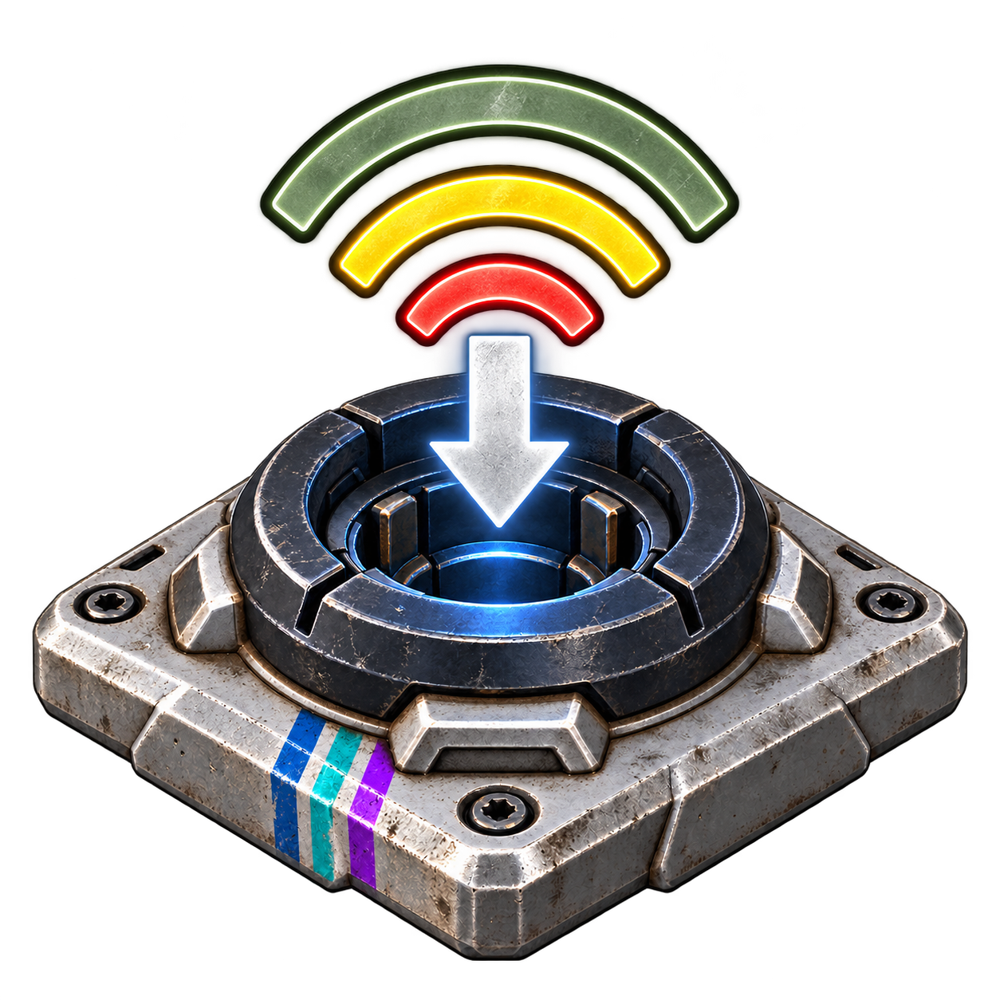

# Ein Sender und ein Empfänger für alle Ressourcen

Der **Universal-Funksender (1.000 m)** und der **Universal-Funkempfänger** besitzen jeweils zehn getrennte Anschlüsse: Strom, Benzin, Diesel, Rohöl, Frischwasser, Salzwasser, Sauerstoff, CO₂, Methan und Dampf. Ein Universal-Empfänger ersetzt am Ziel bis zu zehn einzelne Empfänger. Die bisherigen Sender und Empfänger bleiben verfügbar.

## Freischalten und anschließen

1. **Universelle Funkversorgung** ab **Level 22** für **vier Skillpunkte** freischalten. Derselbe Skill enthält jetzt beide Universal-Geräte; es gibt keinen zusätzlichen Empfänger-Skill. Den neuen Empfänger als eigenes Gerät herstellen.
2. Universal-Sender bauen, mit ausreichend Strom versorgen und die gewünschten Quellen mit normalen Schläuchen an die passenden Eingänge anschließen. Neun Ressourceneingänge sitzen in drei senkrechten Gruppen um den Sender, Strom hat einen eigenen Anschluss.
3. Sender anvisieren, **Ö** drücken und einen Kanal von **1 bis 9999** wählen. Standard ist 1. Der Kanal gilt gemeinsam für alle Ressourcen.
4. Einen **Universal-Funkempfänger** am Ziel bauen und mit **Ö auf denselben Kanal** stellen. Er hat einen Stromausgang und neun Flüssigkeits-/Gasausgänge als dreireihiges Anschlussfeld. Alle Anschlüsse gehören zu einem gemeinsam platzierten und verwertbaren Gerät. Die nativen Anschlusssymbole zeigen den jeweiligen Ressourcentyp.
5. Verbraucher mit normalen Kabeln oder Schläuchen an die passenden Ausgänge anschließen. Nicht benötigte Ressourceneingänge und Ausgänge dürfen frei bleiben.

Beispiel: Diesel-Tank und Methan-Tank an denselben Universal-Sender anschließen und diesen mit Strom versorgen. Sender und Universal-Empfänger auf Kanal 12 einstellen. Am Empfänger führt ein Treibstoffschlauch vom Diesel-Ausgang zum Dieselgenerator; ein Gasschlauch führt vom Methan-Ausgang zum Methanverbraucher. Der Stromausgang kann zusätzlich elektrische Verbraucher versorgen. Es werden keine Stoffe umgewandelt.

Der **Universal-Empfänger benötigt den Universal-Sender**. Ein einzelner spezialisierter Sender versorgt ihn nicht. Der Universal-Sender kann weiterhin zusätzlich die bisherigen passenden Einzelempfänger versorgen. Für unabhängige Anlagen unterschiedliche Kanäle verwenden: Sender auf demselben Kanal können um passende Empfänger konkurrieren; eine vorhandene, versorgte Zuordnung bleibt zunächst bestehen.

## Werte

| Eigenschaft | Wert |
|---|---|
| Reichweite | 1.000 m |
| Freischaltung beider Geräte | Level 22, vier Skillpunkte, Universelle Funkversorgung |
| Universal-Sender herstellen | 20 Kunststoff + 20 Eisen, 30 Sekunden, 80 Wh |
| Universal-Empfänger herstellen | 16 Kunststoff + 16 Eisen, 20 Sekunden, 50 Wh |
| Eigenbedarf am Universal-Sender | 3 kW + 1 kW je verbundenem Empfängergerät |
| Ein Universal-Paar | 4 kW Eigenbedarf, zusätzlich zum weitergeleiteten Strom |
| Flüssigkeits-/Gasanschlüsse | Je 72.000 Einheiten/h nominell |
| Senderpuffer | Je 1.000 Einheiten pro Ressource, 1 kWh Strom |

**Zehn Ausgänge an einem Universal-Empfänger zählen als ein Empfängergerät.** Zwei Universal-Empfänger benötigen zusammen mit einem Sender 5 kW Eigenbedarf. Mehrere Empfänger derselben Ressource teilen den verfügbaren Zufluss. Quelle, Verbraucher und Spielnetz bestimmen den tatsächlichen Durchsatz. Unzureichende Stromversorgung sperrt alle Ausgänge; Kanalwechsel und überschrittene Reichweite lösen die ganze Zuordnung.

## Performance und Umfang

Ein Universal-Empfänger ist ein Actor mit zehn nativen Anschlüssen und wiederverwendeten Anschlussplatten. Der Sender führt weiterhin einen räumlichen Empfängersuchlauf pro Sekunde aus. Die bestehende gemeinsame Hintergrund-Erkennung läuft alle fünf Sekunden, unterstützt jetzt 22 Gerätetypen und behält ihre bisherigen Schutzgrenzen. Es gibt keine zusätzliche Schleife zum Kopieren oder Erzeugen von Ressourcen. Die Stromberechnung zählt die unterschiedlichen Empfänger hinter den vorhandenen Anschlüssen.

Daten-/Steuersignale und Inventargegenstände gehören nicht zur Ressourcenübertragung. Die mehrfarbigen Icons unterscheiden Sender und Empfänger; sie sind keine technische Zeichnung der Anschlussanordnung.

## Installation und Prüfstatus

Im vollständigen Modpack und in der separaten Wireless-Mod enthalten, weiterhin **Version 1.0.0**. Voraussetzungen und Installation: [README.md](README.md). Bei geschlossenem Spiel das komplette Wireless-Paket ersetzen und danach das Spiel vollständig neu starten. Nur eine Paketkopie installieren. AssetBridge 0.4.0 registriert jetzt **30 zusätzliche Item-/Skill-Einträge** der Wireless-Mod. Bestehende Geräte werden nicht automatisch in Universal-Geräte umgewandelt. Spielstände werden vom Installer nicht bearbeitet.

Offline geprüft: zehn Ausgänge, Verweise und gemeinsame Freischaltung, eindeutige Anschluss-IDs, Paket-Rückextraktion, Blueprint-Sprungadressen sowie Ö- und Hintergrund-Erkennung für 22 Gerätetypen. Tests des serialisierten Kontrollflusses prüfen Anschließen, Wiederholungen, Stromausfall und Wiederanlauf, Kanalwechsel an beiden Geräten, Reichweitenwechsel und die Zählung gemischter Empfänger. Native Engine-Aufrufe sind dabei simuliert. 78 der vorherigen 80 Pakete bleiben bytegleich; Universal-Sender und gemeinsamer Skill sind gezielt angepasst, drei Pakete kommen hinzu.

**Der Spieltest des gleichzeitigen nativen Ressourcenflusses, der Platzierung/Erreichbarkeit aller Anschlüsse, des Verwertens und des Speicherns/Ladens steht aus.** Für diese Arbeiten wurde das Spiel nicht gestartet. Offline-Prüfungen ersetzen keinen Test der echten Unreal-Simulation. Bericht: [verification/universal-receiver-tests.json](verification/universal-receiver-tests.json).
