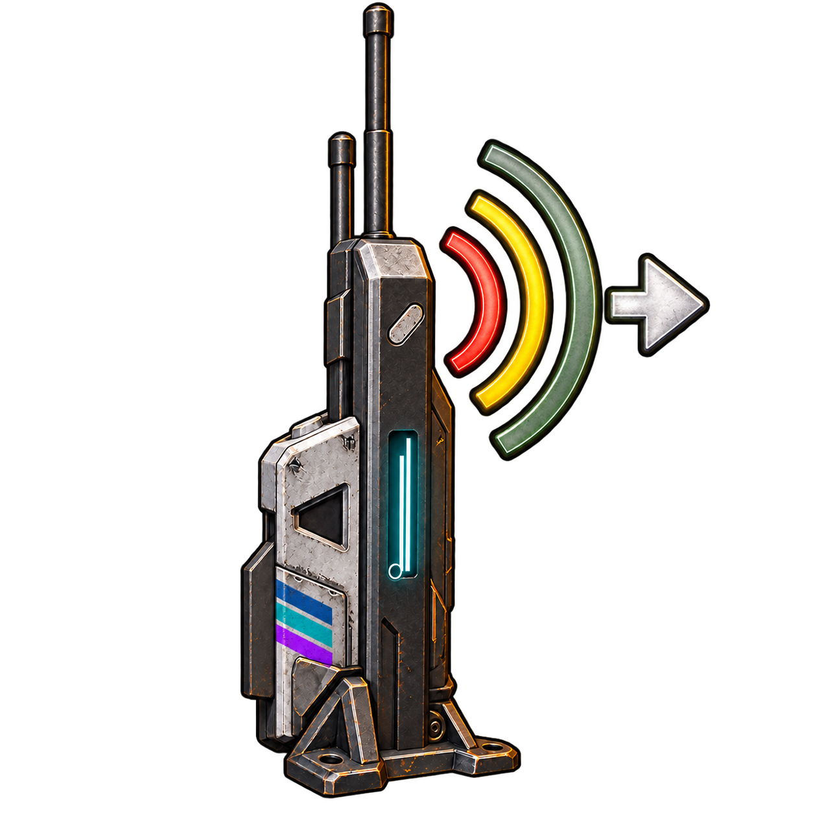

# Ein Sender für alle Ressourcen

Der **Universal-Funksender (1.000 m)** hat zehn getrennte Eingänge: einen Stromanschluss und je einen Anschluss für Benzin, Diesel, Rohöl, Frischwasser, Salzwasser, Sauerstoff, CO₂, Methan und Dampf. Er ist ein zusätzliches Gerät. Die bisherigen Sender und Empfänger bleiben verfügbar.

## Freischalten und anschließen

1. **Universelle Funkversorgung** ab **Level 22** für **vier Skillpunkte** freischalten. Das Rezept benötigt **20 Kunststoff und 20 Eisen**, 30 Sekunden und 80 Wh Fertigungsstrom. Die Ressourcen-Empfänger werden weiterhin durch ihre bisherigen Skills freigeschaltet.
2. Einen Universal-Funksender bauen und den Stromanschluss mit einer ausreichenden Stromquelle verbinden.
3. Die gewünschten Ressourcen mit ihren normalen Schläuchen an die jeweiligen Eingänge anschließen. Die neun Ressourceneingänge sind in drei senkrechten Gruppen um den Sender angeordnet. Um das Gerät herumgehen, um alle Anschlüsse zu erreichen. Die nativen Anschlusssymbole kennzeichnen die Ressourcen. Nicht benötigte Ressourceneingänge dürfen frei bleiben.
4. Sender anvisieren, **Ö** drücken und einen Kanal von **1 bis 9999** wählen. Standard ist 1. Der Kanal gilt gemeinsam für alle Ressourcen dieses Senders.
5. Am Ziel die vorhandenen passenden Empfänger bauen, mit **Ö auf denselben Kanal** stellen und per passendem Schlauch beziehungsweise Stromkabel mit dem Verbraucher verbinden. Ein Diesel-Empfänger entnimmt Diesel, ein Methan-Empfänger Methan, ein Funkstrom-Empfänger Strom. Es werden keine Stoffe umgewandelt.

Beispiel: Diesel-Tank und Methan-Tank mit zwei Schläuchen an denselben Universalsender anschließen und diesen mit Strom versorgen. Sender und beide Empfänger auf Kanal 12 einstellen. Am Ziel versorgt der Diesel-Empfänger einen Dieselgenerator; der Methan-Empfänger einen Methanverbraucher.

Für eine getrennte Anlage einen anderen Kanal verwenden. Ein Universal- und ein spezialisierter Sender auf demselben Kanal konkurrieren um die passenden Empfänger; vorhandene, versorgte Zuordnungen werden wie bisher beibehalten. Für unabhängige Quellen daher unterschiedliche Kanäle nutzen.

## Werte und Technik

- Reichweite **1.000 m**, ein gemeinsamer Funkkanal, native getrennte Ressourcenflüsse.
- **3 kW Eigenbedarf plus 1 kW je verbundenem Empfänger**, zusätzlich zum weitergeleiteten Strom. Zwei verbundene Empfänger benötigen daher 5 kW Eigenbedarf. Ohne ausreichende Stromversorgung stoppt die Übertragung.
- Je Flüssigkeit/Gas **72.000 Einheiten/h nomineller Anschlussdurchsatz** und **1.000 Einheiten Puffer**, dazu **1 kWh Strompuffer**. Die tatsächlich verfügbare Menge hängt von Quellen, Verbrauchern und dem Spielnetz ab; mehrere Empfänger derselben Ressource teilen den Zufluss.
- Ein Sender-Actor, zehn native Anschlüsse und **ein räumlicher Empfängersuchlauf pro Sekunde**. Kein zusätzliches Skript zum Kopieren oder Erzeugen von Ressourcen. Die bestehende Hintergrund-Erkennung führt weiterhin einen gemeinsamen Scan alle fünf Sekunden aus und erkennt jetzt 21 Gerätetypen. Die bisherigen Schutzgrenzen bleiben bestehen.
- Normale Kabel und Schläuche verwenden. Ein einzelner Anschluss kann nicht gleichzeitig zehn Schläuche aufnehmen; deshalb besitzt das Gerät zehn getrennte Eingänge. Daten-/Steuersignale und Inventargegenstände gehören nicht zu dieser Ressourcenübertragung.

## Installation und Prüfstatus

Enthalten in der separaten Wireless-Mod und im vollständigen Modpack, weiterhin **Version 1.0.0**. Installation wie in [README.md](README.md), mit UE4SS und AssetBridge 0.4.0. Die Einzelmod registriert jetzt **29 zusätzliche Item-/Skill-Einträge**. Nur eine Paketkopie installieren und das Spiel nach dem Dateiaustausch vollständig neu starten. Bestehende Geräte und Spielstände werden nicht migriert; der Universalsender muss als neues Gerät gefertigt werden.

Offline geprüft: alle zehn Anschlüsse und Puffer, Empfängerschnittstellen, Kanal-/Stromprüfung, neue Freischaltung, Paketpfade, Rückextraktion und Blueprint-Sprungadressen. Vier Lua-Tests prüfen den gemeinsamen Gerätefilter, Ö-Bedienung, gespeicherte Netze und Hintergrund-Erkennung. Alle 76 vorherigen Assets bleiben bytegleich. Bericht: [verification/universal-tests.json](verification/universal-tests.json).

**Ein Spieltest des gleichzeitigen Ressourcenflusses und der räumlichen Anschlussbedienung steht aus.** Für diese Arbeiten wurde das Spiel nicht gestartet. Offline-Prüfungen bestätigen die Paketstruktur und Logik, ersetzen aber keine Prüfung der nativen Simulation, Platzierung und Speicherung im Spiel.
